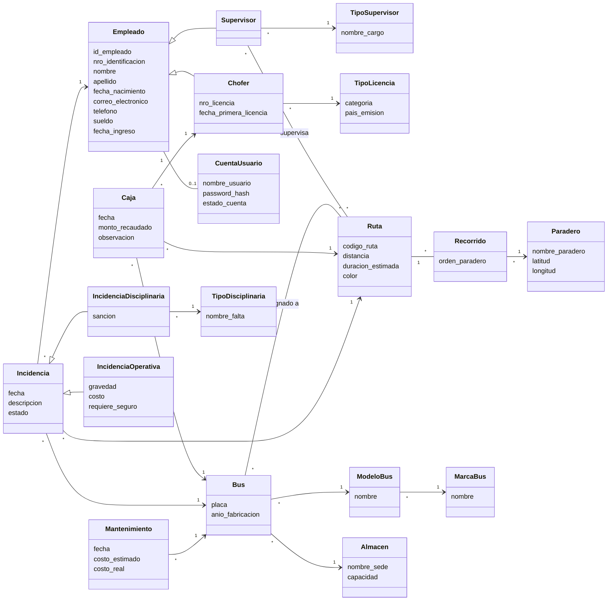
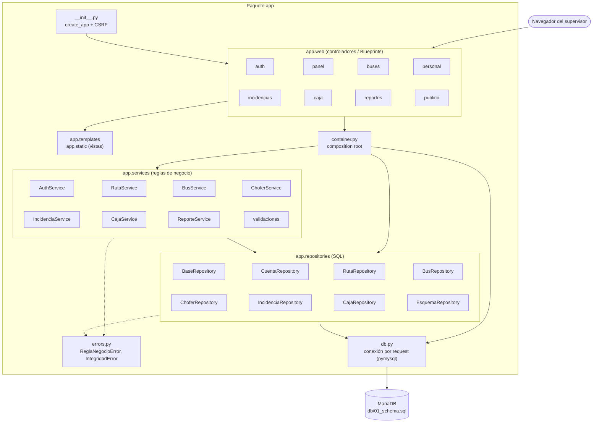

# STELMAN-BUSES

Proyecto Final de Ingeniería de Software II · Universidad Católica San Pablo · Docente: Edgar Sarmiento Calisaya

## Índice

1. [Equipo de trabajo](#equipo-de-trabajo)
2. [Propósito del proyecto](#propósito-del-proyecto)
3. [Funcionalidades](#funcionalidades)
4. [Modelo de dominio](#modelo-de-dominio)
5. [Visión general de la arquitectura](#visión-general-de-la-arquitectura)
6. [Módulos y servicios REST](#módulos-y-servicios-rest)
7. [Cómo ejecutarlo y probarlo](#cómo-ejecutarlo-y-probarlo)
8. [Pipeline CI/CD](#pipeline-cicd)
9. [Gestión de tareas y releases](#gestión-de-tareas-y-releases)

## Equipo de trabajo

Equipo: **STELMAN-BUSES**

| Integrante | Usuario de GitHub |
|---|---|
| Ponce Molina, Ángel Fernando | [FerPonce42](https://github.com/FerPonce42) |
| Benique Huaman, Ruth Mery | [ru0505](https://github.com/ru0505) |
| Rocha Alvis, Nicol Fernanda | [NicolFer](https://github.com/NicolFer) |
| Luna Carpio, Maricielo Karen | [CieloKaren](https://github.com/CieloKaren) |
| Tacca Chambilla, Arnolsmith Anderson | [Arleondo](https://github.com/Arleondo) |
| Suico Cornejo, Iair Alejandro | [iairalejandro](https://github.com/iairalejandro) |

## Propósito del proyecto

Stelman Buses es un sistema de gestión de flota para supervisores de ruta: administra buses, choferes, incidencias y caja. Está hecho con Flask y MariaDB. En este proyecto final se evoluciona la aplicación con un pipeline de CI/CD en Jenkins que construye, analiza, prueba y despliega la aplicación en cada commit.

## Funcionalidades

Capturas de la aplicación: ver [docs/readme/iair.md](docs/readme/iair.md).

## Modelo de dominio

El dominio gira en torno a las rutas: los supervisores supervisan rutas, los buses se asignan a rutas, y sobre cada ruta se registran la caja (recaudación de cada chofer con su bus) y las incidencias, que pueden ser disciplinarias u operativas. Supervisor y Chofer son tipos de Empleado.



## Visión general de la arquitectura

La aplicación sigue una arquitectura en capas sobre el patrón MVC de Flask: los controladores (`app.web`) reciben el request y devuelven HTML, los servicios (`app.services`) concentran las reglas de negocio y validaciones sin SQL, y los repositorios (`app.repositories`) contienen todo el SQL. `container.py` arma cada servicio con su repositorio y la conexión del request.



Estructura del repositorio:

```
app/
  web/            # controladores (Blueprints): reciben el request, llaman al servicio, devuelven HTML
  services/       # reglas de negocio y validaciones (sin SQL, sin Flask)
  repositories/   # todo el SQL, una clase por agregado
  templates/ static/
  container.py    # arma servicios con la conexión del request
db/               # 01_schema.sql (dump), 02_seed_dev.sql (datos de desarrollo)
tests/services/   # pruebas unitarias con unittest.mock (sin BD)
tests/integration/# flujo completo contra BD real
```

## Módulos y servicios REST

| Módulo     | web/           | services/            | repositories/               |
|------------|----------------|----------------------|-----------------------------|
| Acceso     | auth.py        | auth_service.py      | cuenta_repository.py        |
| Dashboard / rutas / sitio público | panel.py, publico.py | ruta_service.py | ruta_repository.py |
| Buses      | buses.py       | bus_service.py       | bus_repository.py           |
| Choferes   | personal.py    | chofer_service.py    | chofer_repository.py        |
| Incidencias| incidencias.py | incidencia_service.py| incidencia_repository.py    |
| Caja       | caja.py        | caja_service.py      | caja_repository.py          |
| Reportes   | reportes.py    | reporte_service.py   | esquema_repository.py       |

La API está documentada con OpenAPI y Swagger.

| Operación | Descripción |
|---|---|
| `POST /api/v1/login` | Recibe usuario y clave en JSON y devuelve un token |
| `GET /api/v1/buses` | Lista de buses |
| `GET /api/v1/choferes` | Lista de choferes |
| `GET /api/v1/caja` | Lista de recaudaciones |

Los endpoints de lectura responden 200 con token y 401 sin token.

Detalle: [docs/readme/nicol.md](docs/readme/nicol.md)

## Cómo ejecutarlo y probarlo

Requisito: Docker Desktop.

```bash
docker compose up --build
```

- App: http://localhost:5000
- Usuario de prueba: `aperez_sup` / `stelman123` (solo desarrollo, lo crea `db/02_seed_dev.sql`)
- BD para DBeaver/Workbench: `localhost:3307`, usuario `stelman`, clave `stelman`

Los scripts de `db/` solo se ejecutan la primera vez (volumen vacío). Si cambias el esquema y quieres recargarlo desde cero: `docker compose down -v && docker compose up --build`.

Pruebas:

```bash
pip install -r requirements-dev.txt
pytest                                  # unitarias (no necesitan BD)
RUN_INTEGRATION=1 pytest                # + integración (BD corriendo: docker compose up db)
```

Para integración fuera de Docker: `DB_HOST=127.0.0.1 DB_PORT=3307 RUN_INTEGRATION=1 pytest`.

Variables de entorno: `DB_HOST`, `DB_PORT`, `DB_NAME`, `DB_USER`, `DB_PASSWORD`, `SECRET_KEY`, `ALMACEN_POR_DEFECTO` (ver `.env.example`; docker-compose ya trae valores de desarrollo).

## Pipeline CI/CD

El pipeline está implementado en Jenkins y se dispara con cada commit. Cada etapa tiene su sección:

| Etapa | Encargado/a | Sección |
|---|---|---|
| Pipeline (Jenkinsfile), construcción automática y despliegue con Docker | Ruth | [docs/readme/ruth.md](docs/readme/ruth.md) |
| Análisis estático (SonarQube) y pruebas unitarias | Nicol | [docs/readme/nicol.md](docs/readme/nicol.md) |
| Pruebas de seguridad (OWASP ZAP) y pruebas de API (Postman/Newman) | Maricielo | [docs/readme/maricielo.md](docs/readme/maricielo.md) |
| Pruebas funcionales (Selenium) y gestión de issues | Iair | [docs/readme/iair.md](docs/readme/iair.md) |
| Pruebas de rendimiento (JMeter) | Webster | [docs/readme/webster.md](docs/readme/webster.md) |

## Gestión de tareas y releases

Las tareas se gestionan en el GitHub Project **PROYECTO FINAL - Stelman Buses**, con las etapas TO-DO, Current Iteration, In Progress, Fix Validation y Done, y las etiquetas Nuevo requisito, Mejora y Corrección. Cada tarea es un issue y sus commits se vinculan con `Fix #n`.

Ramas: `main`, `development` y una rama `feature/<tarea>` por tarea. La planificación del release sigue el recorrido GitHub Project → Issues → Commits → GitHub Release.
